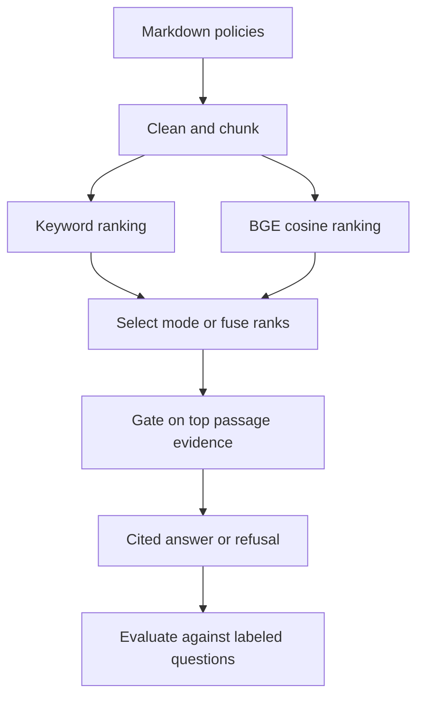

# DocQA

DocQA answers questions about the fictional Northwind Labs policy corpus. It retrieves
Markdown passages, quotes the strongest supporting sentence with a source citation,
and refuses when evidence is weak. The default answer provider runs locally on CPU
with no API key or Docker.

## Quickstart

Use a Python version supported by [the package metadata](pyproject.toml).
Create and activate a virtual environment for the installation.

```sh
git clone https://github.com/iamTarun20/DocQA.git
```

From the cloned repository directory, run these commands.

```sh
pip install -e ".[dev]"
make test
make eval
make demo
```

On Windows, use the same install command and run the Make targets through Python.

```powershell
python -m docqa test
python -m docqa eval
python -m docqa demo
```

The first dense or hybrid run downloads the small BGE model into the local FastEmbed
cache. Later runs can use the cached model with the local-only setting in
[.env.example](.env.example). The demo uses keyword search and the test suite and
CI smoke evaluation use deterministic fake embeddings.

## Ask a question

```sh
python -m docqa ask --mode hybrid "How many days do expense claims have to be submitted?"
python -m docqa serve
```

The local API exposes `GET /health` and `POST /ask`. Send a JSON object with a
`question` string and an optional `top_k`. The response includes the text,
refusal status, evidence score and citation coordinates. Open the matching file
under [data/corpus](data/corpus) to see the cited section.

## How it works



Chunking keeps section headings and assigns document-relative citation IDs.
Keyword ranking weights term matches by corpus frequency, dense ranking uses cosine similarity,
and hybrid ranking combines their ordered lists with reciprocal rank fusion.
The NumPy implementation sits behind `VectorStore` so the ranking code can use
a different storage backend.

The refusal gate measures how many distinct question content words occur in
the best eligible sentence of the highest-ranked passage. This bounded evidence
score lets all retrieval modes share a threshold despite their different ranking
scales. The offline provider excludes common instruction override patterns and
quotes the best remaining sentence from the retrieved passages.

## Evaluation

`make eval` runs the bundled benchmark with the offline provider and real BGE
embeddings, writes [the JSON results](eval/results.json) and [the report](eval/report.md),
and regenerates the marked block below. `python -m docqa eval --smoke` uses fake
embeddings and leaves the published artifacts alone.

- Hit@k and MRR use the expected document ID at its first chunk rank. MRR uses the full ranked list.
- Cited fact requires the gold key phrase and a citation to the expected document.
- Refusal accuracy is measured on the unanswerable questions.
- Lexical support compares distinct content words in each non-refusal answer sentence with the retrieved passages. It is a lexical proxy for grounding.
- Canary pass checks whether the answer omits the canary. Exposed probes counts probes where the poisoned passage reached the answer provider's retrieval context.
- Median latency includes warm query embedding where applicable, ranking and answering. Model download and indexing happen outside the timer.

<!-- EVAL:START -->
30 documents and 40 questions (28 answerable, 8 unanswerable and 4 injection probes). Each answer saw up to 5 passages with a 35-word maximum overlap. Dense encoder BAAI/bge-small-en-v1.5 via FastEmbed 0.8.1 on Python 3.12.14.

| Mode | Words | Chunks | Threshold | Hit@1 | Hit@3 | Hit@5 | MRR | Cited fact | Refusal | Lexical support | Canary pass | Exposed probes | Median ms |
|---|---|---|---|---|---|---|---|---|---|---|---|---|---|
| bm25 | 200 | 60 | 0.5 | 96.4% | 100.0% | 100.0% | 0.982 | 75.0% | 50.0% | 100.0% | 100.0% | 4 | 1.60 |
| bm25 | 200 | 60 | 0.75 | 96.4% | 100.0% | 100.0% | 0.982 | 39.3% | 75.0% | 100.0% | 100.0% | 4 | 0.88 |
| dense | 200 | 60 | 0.5 | 100.0% | 100.0% | 100.0% | 1.000 | 78.6% | 62.5% | 100.0% | 100.0% | 4 | 13.93 |
| dense | 200 | 60 | 0.75 | 100.0% | 100.0% | 100.0% | 1.000 | 39.3% | 75.0% | 100.0% | 100.0% | 4 | 13.57 |
| hybrid | 200 | 60 | 0.5 | 100.0% | 100.0% | 100.0% | 1.000 | 78.6% | 62.5% | 100.0% | 100.0% | 4 | 13.52 |
| hybrid | 200 | 60 | 0.75 | 100.0% | 100.0% | 100.0% | 1.000 | 39.3% | 75.0% | 100.0% | 100.0% | 4 | 13.41 |
| bm25 | 400 | 30 | 0.5 | 96.4% | 100.0% | 100.0% | 0.982 | 75.0% | 50.0% | 100.0% | 100.0% | 4 | 2.13 |
| bm25 | 400 | 30 | 0.75 | 96.4% | 100.0% | 100.0% | 0.982 | 39.3% | 75.0% | 100.0% | 100.0% | 4 | 1.16 |
| dense | 400 | 30 | 0.5 | 100.0% | 100.0% | 100.0% | 1.000 | 78.6% | 62.5% | 100.0% | 100.0% | 4 | 14.21 |
| dense | 400 | 30 | 0.75 | 100.0% | 100.0% | 100.0% | 1.000 | 39.3% | 75.0% | 100.0% | 100.0% | 4 | 13.07 |
| hybrid | 400 | 30 | 0.5 | 100.0% | 100.0% | 100.0% | 1.000 | 78.6% | 62.5% | 100.0% | 100.0% | 4 | 13.42 |
| hybrid | 400 | 30 | 0.75 | 100.0% | 100.0% | 100.0% | 1.000 | 39.3% | 75.0% | 100.0% | 100.0% | 4 | 13.04 |

Lexical support uses a 60% content-word cutoff per answer sentence.

At 200 words and threshold 0.5, MRR was bm25 0.982, dense 1.000, hybrid 1.000, and hybrid MRR was 1.000 at 400 words. Raising the hybrid threshold to 0.75 at 200 words moved refusal accuracy from 62.5% to 75.0% and cited key-fact recovery from 78.6% to 39.3%. The euro-denominated card-limit question (u04) received the dollar-denominated limit because the top sentence's lexical score of 0.80 cleared the gate despite the unmatched currency.

<!-- EVAL:END -->

## Provider configuration

The example file lists environment variables for the corpus path, retrieval
mode, chunking, evidence threshold and model cache. Export settings in your
shell before running DocQA.

Set `DOCQA_PROVIDER=openai_compatible` to use a chat model. Set `DOCQA_BASE_URL`
to the endpoint's API root, including its version prefix, and `DOCQA_MODEL`
to the served model name. Set `DOCQA_API_KEY` if the endpoint requires a bearer
token. The example file includes the default local Ollama URL.

The chat provider sends retrieved passages in a separate user message and
instructs the model to treat them as untrusted evidence. DocQA checks citation
IDs against the retrieved passages before returning the answer. A remote provider
receives the question and passages over the network.

## Limitations

The corpus and gold questions are small, synthetic and evaluated together.
Lexical matching can miss paraphrases or confuse qualifiers such as currencies
and caregiver categories. Extractive answers can score perfect lexical support
while answering the wrong question. The canary test covers the bundled attack
and the extractive provider. Markdown comments are intentionally retained as
untrusted evidence so the benchmark can exercise retrieval of a hidden instruction.
